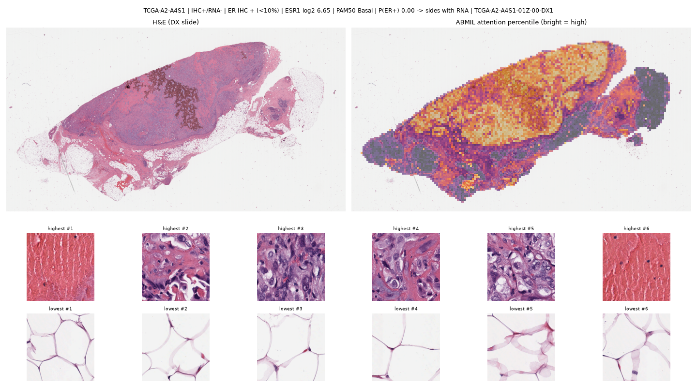
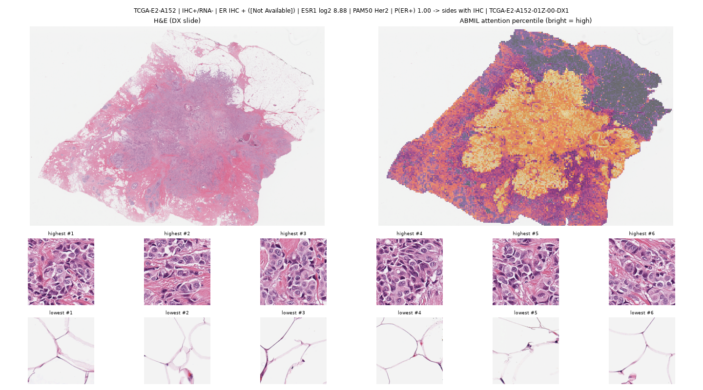

# Abstract

Hormone-receptor and HER2 status guide breast-cancer therapy and are measured clinically by immunohistochemistry (IHC),
but IHC disagrees with RNA expression and with DNA amplification in a minority of tumours. Deep-learning models that
predict these markers from H&E slides are trained on whichever label is available, and it is unclear which biological
"truth" they actually learn. Using 1,055 TCGA-BRCA patients, five frozen-encoder models (TITAN, UNI v1 and CONCH v1 with
linear or attention-MIL heads) and fixed site-grouped cross-validation, we compared, on the same patients and folds,
how predictable each reference standard is from H&E (1a), which side a model trained on concordant cases takes on
discordant cases (1b), whether HER2-low is visible at all (1d), whether the answer changes between the FFPE diagnostic
slide and the frozen slide cut next to the sequenced tissue (1c, 1,515 frozen slides extracted for this study), and how
reproducible predictions are across two frozen sections of one tumour (1e). The RNA-defined ER label was more
predictable than the IHC label in all five models (ΔAUC +0.02 to +0.06; DeLong CI excluding zero in 4 of 5; primary model
Holm-adjusted p = 0.042), and the advantage was identical on FFPE and frozen slides (interaction 0.000, 95% CI −0.024 to
+0.024). On ER-discordant patients the models leaned towards RNA (consensus 34 : 20, p = 0.076; 39 : 13 on frozen slides),
and their calls followed the PAM50 intrinsic subtype. HER2 predictions tracked amplification rather than the clinical
label; PR showed no reliable preference; HER2-low was not detectable from H&E. Two frozen sections of one tumour agreed
well (ICC ≈ 0.88) but about one ER call in ten flipped. H&E models therefore learn morphology that aligns with the
transcriptional state of a tumour rather than with its IHC readout, which matters for how such models are trained,
validated and interpreted.

# 1. Clinical problem

ER, PR and HER2 status decide endocrine and anti-HER2 therapy. They are measured by IHC (and ISH for equivocal HER2),
which is semi-quantitative, depends on pre-analytics and reader thresholds, and disagrees with RNA or DNA measurements in
5-17% of TCGA-BRCA tumours (ER 5.5%, PR 16.7%, HER2 10.8%). Many recent studies predict these markers from H&E with
pathology foundation models and report AUCs against IHC. When the "ground truth" itself is uncertain, a higher AUC
against IHC does not tell us what the model has learned, and a model that is "wrong" against IHC may be right against
RNA. Low-expression categories (ER-low, HER2-low) are exactly where this matters clinically.

# 2. Question and novelty

**Question.** When IHC, RNA and protein measurements of ER/PR/HER2 disagree, which one does an H&E foundation-model
classifier follow, and does the answer change between the FFPE diagnostic slide and the frozen slide cut from the
sequenced tissue?

**Novelty.** Prior work benchmarks many foundation models for ER/PR/HER2 against a single (IHC) label, including
TCGA → CPTAC transfer (Neidlinger et al., 2025; Fernandez-Romero et al., 2026). We do not propose a new architecture. The
contribution is a stricter evaluation: the same patients, slides and folds evaluated against different reference
standards, with site-grouped validation, a discordant-case test, and the first comparison of FFPE vs frozen slides from
the same tumours for this question.

# 3. Data

| Item | Value |
|---|---|
| Cohort | TCGA-BRCA, 1,097 patients from 40 tissue-source sites; 1,055 with DX-slide features |
| IHC labels | ER, PR (clinical biotab); HER2 "strict" = IHC 3+ or FISH+ vs IHC 0/1+ or 2+ FISH− (the TCGA HER2 field includes IHC 1+/2+ cases called positive) |
| RNA labels | ESR1, PGR, ERBB2 log2 RSEM; positive = high component of a 2-component Gaussian mixture (cut-offs 10.17 / 8.58 / 15.14); robustness: prevalence-matched and confident-only cut-offs |
| DNA / protein | ERBB2 amplification (GISTIC 2); RPPA ER-α and HER2 (GMM) |
| Discordance | ER IHC vs RNA 57 / 1,031; PR 172 / 1,028; HER2 strict vs amplification 64 / 591 |
| FFPE slides (DX) | 1,131 slides; UNI v1 / CONCH v1 / TITAN features from the public TRACE resource |
| Frozen slides | 1,044 top (TS) + 471 bottom (BS) sections of the sequenced tissue portion; 373 TS+BS pairs; 1,515 unique slides extracted by us |
| Ancillary | PAM50 subtype; % tumour cells per frozen slide (biospecimen table) |

# 4. Methods

**Features.** Frozen pretrained encoders only: UNI v1 (ViT-L, 1,024-d patch features, main encoder), CONCH v1 (512-d,
replication), TITAN (768-d slide embedding, fast baseline). DX features came from TRACE. Frozen slides were downloaded
from the NCI Imaging Data Commons copy of TCGA (DICOM-WSI on Google Cloud; GDC was too slow from our cluster) and encoded
with TRIDENT (tissue segmentation, 256 px patches at 20×) + UNI v1. An extraction-equivalence check re-encoded 46 DX
slides with this pipeline: slide-mean features matched TRACE exactly (cosine 1.0000 vs 0.33 for different patients;
maximum per-feature difference ≤ 0.002; identical ER calls on 46/46), so DX and frozen features differ only in the tissue.

**Heads.** Logistic regression on the mean of all patch features (or the TITAN embedding), C = 0.01, class-balanced; and
gated attention-MIL (ABMIL; Ilse et al., 2018), 15 epochs, 2,048 patches per training step, up to 4,096 per patient.

**Validation.** Patient-level 5-fold cross-validation **grouped by tissue-source site**, from one fixed split file used by
every experiment (5 seeds for linear models, 3 for ABMIL). Site grouping matters: embeddings identify the hospital 82% of
the time, and a HER2-low signal that appears with random folds (AUC 0.63) vanishes with site-grouped folds.

**Experiments.**
- **1a** For each marker, one model per reference label on the same patients and folds; ΔAUC (molecular − IHC) with a
  DeLong test generalised to two reference labels on the same patients (per-patient influence terms; it reduces exactly
  to DeLong, 1988, when the labels coincide) and a paired bootstrap.
- **1b** Train on concordant patients, score discordant ones, count which label the call agrees with (binomial test);
  combine the five models at patient level (one consensus call per patient) because they score the same patients.
- **1c** On patients with both slide types: the 2 × 2 design DX/TS × IHC/molecular label; interaction
  (TS Δ − DX Δ) with a paired bootstrap; split by % tumour cells.
- **1d** HER2 0 vs 1+ and 0 vs low from H&E, compared with ERBB2 mRNA alone on the same patients.
- **1e** ER model trained on TS slides of out-of-fold patients, applied to both TS and BS of each pair: ICC(2,1),
  Cohen's κ, % flipped calls.

**Statistics and claims.** Three primary claims (ER 1a, 1b, 1c) on a pre-specified primary model (UNI mean-pool) with
Holm correction; all other results are secondary, reported for every model, and called robust only if consistent in
direction across at least two encoders and across RNA cut-offs. Sanity checks S1-S15 (prediction integrity, pairing,
label identity, recomputed statistics, negative controls, cohort sizes, extraction equivalence) all pass except one
explained environment difference (Section 6).

# 5. Results

All numbers below come from the fixed splits and one software environment (full tables: `docs/FINAL_RESULTS.md`).

## 5.1 1a: which label is more predictable from H&E?

ΔAUC (molecular − IHC label), same patients, DeLong 95% CI; **bold** = CI excludes 0.

| Comparison | n | TITAN | UNI mean | CONCH mean | UNI ABMIL | CONCH ABMIL |
|---|---|---|---|---|---|---|
| ER: RNA − IHC | 801 | **+0.057** | **+0.036** | **+0.030** | +0.018 | **+0.045** |
| ER: RPPA − IHC | 801 | +0.026 | **+0.041** | **+0.033** | +0.000 | +0.000 |
| PR: RNA − IHC (prevalence-matched) | 986 | **+0.033** | – | – | −0.002 | +0.007 |
| HER2: amplification − strict | 478 | +0.044 | **+0.071** | **+0.074** | +0.032 | **+0.080** |

The RNA-defined ER label is more predictable than the IHC label in every model (CI excludes zero in 4 of 5; the result
also holds with prevalence-matched and confident-only RNA cut-offs). HER2 amplification is more predictable than the
strict clinical label in all five (significant in three). For PR, an apparent IHC advantage under the GMM cut-off
disappears with a prevalence-matched cut-off: no reliable preference.

## 5.2 1b: which side on discordant patients?

| Discordant pair | n | Per model (TITAN / UNI m / CONCH m / UNI A / CONCH A) | Consensus molecular : IHC |
|---|---|---|---|
| ER: IHC vs RNA | 54 | 39 / 34 / 35 / 34 / 36 | 34 : 20 (p = 0.076); 66% of calls side with RNA (54-76%) |
| ER: IHC vs RPPA | 63 | 33 / 35 / 32 / 34 / 30 | 33 : 30 (p = 0.80) |
| PR: IHC vs RNA (prevalence-matched) | 133 | 69 / – / – / 64 / 63 | 67 : 66 (p = 1.00) |
| HER2: strict vs amplification | 60 | 35 / 44 / 39 / 47 / 34 | **42 : 18 (p = 0.003)** |

Every model leans towards RNA for ER, but the honest pooled estimate is suggestive rather than significant on FFPE
slides; on frozen slides the same patients give 39 : 13 (p = 0.0004). HER2 calls side with amplification.

**Who are the discordant patients?** The call follows the intrinsic subtype: all 15 Basal-like IHC+/RNA− tumours are
called ER−, and all 9 Luminal-A IHC−/RNA+ tumours ER+. The exception is HER2-enriched IHC+/RNA− tumours, 8 of 11 called
ER+. Among the 10 ER-low tumours (IHC+, < 10% stained) that are RNA-negative, the model calls 8 ER− on FFPE and 7 on
frozen slides (a lead only, n = 10).

## 5.3 1d: HER2-low

HER2 0 vs 1+ and 0 vs low are at chance from H&E in every model (AUC 0.42-0.54), whereas ERBB2 mRNA alone reaches 0.65
and 0.69 on the same patients. HER2-low is not a morphological phenotype these models can see.

## 5.4 1c: FFPE vs frozen slide

| Label pair | n | DX Δ (95% CI) | TS Δ (95% CI) | Interaction (95% CI) |
|---|---|---|---|---|
| ER: RNA vs IHC | 947 | +0.032 (+0.007, +0.058) | +0.032 (+0.011, +0.055) | **0.000 (−0.024, +0.024)** |
| ER: RPPA vs IHC | 777 | +0.041 | +0.007 | −0.035 (−0.066, −0.001), p = 0.045 |
| PR: RNA vs IHC (prev.-matched) | 944 | −0.003 | +0.026 | +0.029, p = 0.12 |
| HER2: amplification vs strict | 537 | +0.045 | +0.014 | −0.030, p = 0.44 |

The frozen slide cut next to the sequenced tissue prefers the RNA label by exactly as much as the FFPE diagnostic slide,
in both halves of tumour content. The RNA preference is therefore not an artefact of the FFPE block being a different
piece of tumour from the one that was sequenced. Frozen slides were slightly more predictive overall (ER-IHC AUC 0.899
vs 0.881). The borderline ER-RPPA interaction is one of many tests and is not interpreted.

## 5.5 1e: two frozen sections of one tumour

| ER model trained on | Pairs | ICC(2,1) | Cohen's κ | Calls flipped | AUC TS / BS |
|---|---|---|---|---|---|
| IHC label | 368 | 0.871 (0.841-0.896) | 0.725 (0.643-0.803) | 10.9% | 0.891 / 0.877 |
| RNA label | 367 | 0.892 (0.868-0.913) | 0.806 (0.739-0.872) | 7.6% | 0.939 / 0.940 |

Sections of one tumour look alike (feature cosine 0.92 vs 0.71 between patients) and predictions agree well, but about
one binary ER call in ten changes between two sections a few millimetres apart; the flipped pairs sit at the decision
threshold (median |mean P − 0.5| = 0.06, vs 0.42 for pairs that agree). The RNA-trained model is somewhat more reproducible.

## 5.6 Where the model looks

ABMIL attention drawn on the real slides (10 patients) sits on tumour in every slide reviewed; fat, glass and ink get the
least. ER-low Basal tumours attract attention to high-grade, pleomorphic cells resembling the ER-negative reference;
the HER2-enriched exceptions attract attention to cohesive or apocrine-like cells and are called ER+.

# 6. Robustness and sanity checks

- Every RNA-label claim was repeated with GMM, prevalence-matched and confident-only cut-offs; the ER result holds under
  all three, the PR "IHC preference" does not (hence reported as no preference).
- Shuffled-label controls are at chance (0.43-0.51) and site-only models are weak (AUC 0.53-0.59), bounding leakage.
- Fixed splits were introduced after we found that two scikit-learn versions produce different folds from the same seed;
  all final numbers use them. Rerunning ABMIL on the fixed splits lowered UNI ABMIL's ER ΔAUC from +0.034 to +0.018
  (no longer significant): we report the fixed-split value.
- Sanity checks S1-S15 pass; the one exception (S6, CONCH) compares an old laptop run with the Ada run and reflects the
  library difference above, not a data problem.

# 7. Interpretation

Across encoders, heads, cut-offs and slide types, H&E models align more with the transcriptional ER state than with the
IHC readout, and with DNA amplification rather than the clinical HER2 call. The discordant cases suggest why: the model
reads intrinsic-subtype morphology (basal vs luminal), which RNA reflects more faithfully than IHC when the two disagree.
For model development this means that IHC-trained H&E models are partly penalised for being "right" against RNA, and
that IHC-only benchmarks understate how much ER biology the slide carries. For interpretation it means that an H&E model
should not be expected to recover IHC in low-expression or HER2-enriched tumours, and that a single slide is not the
whole tumour (1e).

# 8. Limitations

- One cohort (TCGA-BRCA), retrospective, with heterogeneous IHC practice across 40 sites; an external check on
  CPTAC-BRCA is planned (Tier 6).
- Discordant groups are small (ER 54, HER2 60, ER-low 10): 1b and subgroup findings are suggestive, not definitive.
- RNA "positivity" depends on a cut-off; we tested three, but no cut-off is clinically validated.
- Frozen encoders only; fine-tuning could change which truth is learned (not tested).
- Frozen-slide features come from our extraction (verified equal to TRACE on DX slides); 268 of 653 CPTAC slides and
  48 TCGA DX slides are JPEG-2000 encoded in IDC and could not be read by our pipeline.
- The attention review is qualitative and by non-pathologists.

# 9. Conclusion

When IHC and RNA disagree about ER, H&E foundation-model classifiers side with RNA and with the tumour's intrinsic
subtype, and this does not depend on whether the slide is the FFPE diagnostic slide or the frozen section next to the
sequenced tissue. HER2 predictions track amplification, PR shows no preference, and HER2-low is invisible in H&E.
Reference-standard choice should be reported, and ideally varied, when H&E models of receptor status are developed.

# Reproducibility

Code, job scripts, fixed splits and all result tables are in the project repository (`scripts/`, `jobs/`,
`data/splits/folds.csv`, `results/`); `docs/FINAL_RESULTS.md` lists the final tables and `docs/baseline_report.md` the
detailed results with the command and job that produced each number.

# References

- Chen RJ et al. Towards a general-purpose foundation model for computational pathology (UNI). *Nature Medicine* 2024.
- Lu MY et al. A visual-language foundation model for computational pathology (CONCH). *Nature Medicine* 2024.
- Ding T et al. Multimodal whole slide foundation model for pathology (TITAN). arXiv 2024.
- Ilse M, Tomczak J, Welling M. Attention-based deep multiple instance learning. *ICML* 2018.
- DeLong ER, DeLong DM, Clarke-Pearson DL. Comparing the areas under two or more correlated ROC curves. *Biometrics* 1988.
- Allison KH et al. Estrogen and progesterone receptor testing in breast cancer: ASCO/CAP guideline update. *J Clin Oncol* 2020.
- Neidlinger P et al. (Kather group). *Nature Biomedical Engineering* 2025, doi:10.1038/s41551-025-01516-3 [benchmark of 19 pathology foundation models incl. ER/PR/HER2, TCGA-BRCA → CPTAC-BRCA].
- Fernandez-Romero et al. *Med Biol Eng Comput* 2026, PMC13269319 [13 foundation models × 3 MIL methods for PAM50 and ER/PR/HER2, TCGA-BRCA → CPTAC-BRCA].
- Fedorov A et al. NCI Imaging Data Commons. *Cancer Research* 2021.
- The Cancer Genome Atlas Network. Comprehensive molecular portraits of human breast tumours. *Nature* 2012.
- TRACE precomputed TCGA features: huggingface.co/datasets/IUCompPath/TRACE. TRIDENT: github.com/mahmoodlab/TRIDENT.
